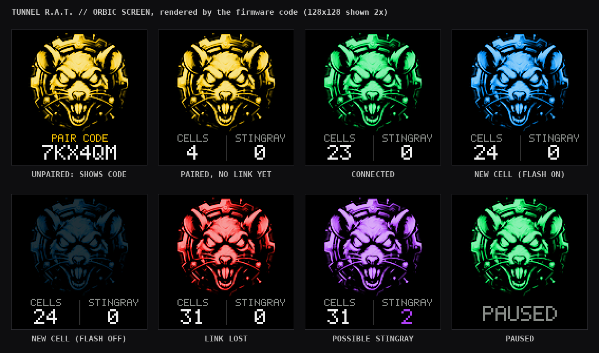

# Ratcatcher


**Tunnel R.A.T.'s stingray detector for the Orbic RC400L.**

Ratcatcher turns a cheap Orbic RC400L hotspot into a stingray detector that pairs with anything using one 6-character code. It is a fork of EFF's [Rayhunter](https://github.com/EFForg/rayhunter) v0.13.0, so everything Rayhunter does still works: its detection heuristics, recordings and its web page at http://192.168.1.1:8080.

It is the first public piece of [Tunnel R.A.T.](https://github.com/CyberChuck01) and a preview of what it can do. It works on its own, with a PiPack, or with anything that can open a web connection.

## What it adds

- **A status rat** on the Orbic's screen that changes colour with what is happening
- **One-time pairing** with a code shown on the screen, instead of setup menus
- **A live link** to whatever you paired with: an API-keyed WebSocket that streams cells, status and stingray alerts
- **Live counters** for the cells it hears and the possible stingrays it has flagged
- **Cell identities** (network, tracking area and cell ID) read from each tower's own broadcast
- **Web page extras:** a Towers list, a Wi-Fi scan, and Themes (Rayhunter, Tunnel R.A.T. Light, Tunnel R.A.T. Dark)
- **A PiPack client** in [`clients/pipack`](clients/pipack) that pairs, keeps the link up, geotags recordings and logs cells next to your wardrive files

## What you need

- **An Orbic RC400L.** It is also sold as the Kajeet RC400L, which is the same hardware. Check that it supports your country's bands on [frequencycheck.com](https://www.frequencycheck.com/countries/) before buying.
- **A SIM card in it.** It does not need an active plan: an inactive SIM is enough to hear towers. Outside the US, use a local carrier's SIM.
- **A computer.** The ready-made installer is for Windows; on macOS or Linux, build it from source (below).
- **The Orbic's admin password.** On a Verizon Orbic it is the Wi-Fi password by default. On a Kajeet/Smartspot it is `$m@rt$p0tc0nf!g`. Forgot it? Hold the button under the back cover until the Orbic restarts to reset it.

## Install

One command does it. There is no need to install Rayhunter first.

1. **Download** `ratcatcher_installer.exe` from the [Releases page](../../releases/latest).
2. **Turn on the Orbic and join its Wi-Fi.** Hold the power button on the front, then connect to its Wi-Fi (USB tethering also works). You are on the right network when http://192.168.1.1 shows the Orbic's own admin page.
3. **Open PowerShell** in the folder with the installer: hold Shift, right-click an empty spot and choose "Open in PowerShell". Use PowerShell, not Command Prompt, or the quotes in the next step break.
4. **Run the installer** with your admin password, keeping the single quotes:

   ```powershell
   .\ratcatcher_installer.exe orbic --admin-password 'YOUR_PASSWORD'
   ```

   Changed the Orbic's admin username or IP address? Add `--admin-username 'NAME'` or `--admin-ip 'IP'`.
5. **Wait for the reboot.** The installer says when it is done and the Orbic restarts. It worked when the screen shows a yellow rat with **PAIR CODE** under it.

**macOS / Linux:** install the tools listed in [Installing from source](doc/installing-from-source.md), then from this repo run:

```bash
./scripts/build-dev.sh
./scripts/install-dev.sh orbic --admin-password 'YOUR_PASSWORD'
```

### Already running Rayhunter?

Install straight over it; your recordings and settings stay. Because your settings stay, the Orbic keeps Rayhunter's old screen until you switch it once:

1. Open http://192.168.1.1:8080 and click **Config**.
2. Set **Device UI Level** to **Ratcatcher (rat, pairing code, counters)**.
3. Click **Apply and restart**.

Adding `--reset-config` to the install command also switches it, but it resets every other setting to its default too.

## Pair it

Pairing happens once: you send the 6-character code from the Orbic's screen and get back an API key that you keep. The code skips look-alike characters (no 0/O or 1/I/L), and it changes after 10 minutes or after 5 wrong tries.

- **PiPack:** the setup in [`clients/pipack`](clients/pipack) asks for the code and does the rest.
- **Anything else** on the Orbic's Wi-Fi (or USB), using your own code and a name for the device:

  ```powershell
  # Windows (PowerShell)
  Invoke-RestMethod -Method Post -Uri http://192.168.1.1:8080/api/tunnel-rat/pair -ContentType 'application/json' -Body '{"code":"7KX4QM","device_name":"My laptop"}'
  ```

  ```bash
  # macOS / Linux
  curl -X POST http://192.168.1.1:8080/api/tunnel-rat/pair -H 'Content-Type: application/json' -d '{"code":"7KX4QM","device_name":"My laptop"}'
  ```

An `api_key` back means it is paired; save it, because it is only shown once. A 401 means a wrong code; a 409 means the Orbic is already paired (see Troubleshooting).

## Reading the screen

The rat's colour tells you the state at a glance, and purple always wins.

| Rat | Meaning |
| --- | --- |
| Purple | Possible stingray. It stays purple until the next recording starts. |
| Red | The link dropped, or went quiet for 20 seconds. |
| Yellow | Not linked yet. Also shown while the pairing code is up. |
| Blue, flashing | A cell it has not heard before just showed up. Flashes for 3 seconds. |
| Green | A paired device is connected over the live link. |

Under the rat, while recording:

- **CELLS:** how many different LTE cells it has heard this recording, counting the one it uses and its neighbours. One tower usually carries several cells, so this runs higher than the number of towers.
- **STINGRAY:** how many times Rayhunter's checks flagged something suspicious. Warnings less than 60 seconds apart count once.

Both reset when a new recording starts, and **PAUSED** shows when it is not recording. A purple rat means *possible*, not confirmed: open http://192.168.1.1:8080 to see what was flagged and why.



## Using it with a PiPack

[`clients/pipack`](clients/pipack) keeps a PiPack linked to Ratcatcher:

- Joins the Orbic to the PiPack's own hotspot, with the Orbic's USB-C tether as a backup that takes over without dropping the link
- Sends the PiPack's GPS fix to the Orbic, so recordings are geotagged
- Logs every new cell and stingray alert, with GPS position, to `~/wardrive/PiPack-orbic-YYYYMMDD.csv`
- Downloads each finished recording to `~/wardrive`, and can start a fresh recording with every wardrive

To set it up from Windows, join the PiPack's hotspot and run `tunnel-rat-orbic_pipack-install.bat`. On the PiPack itself, run `sudo bash tunnel-rat-orbic_pipack-setup.sh` next to `tunnel-rat-orbic_pipack-link.py`.

## For developers: the live link

Connect a WebSocket to `ws://192.168.1.1:8080/api/tunnel-rat/link` with the API key as `Authorization: Bearer <key>` (or `?key=<key>`). The rat stays green while you are connected; send something at least every 20 seconds.

| Direction | Message | When |
| --- | --- | --- |
| Orbic → you | `{"type":"hello",...}` | On connect: firmware, link version, paired name |
| Orbic → you | `{"type":"cells",...}`, `{"type":"cell_ids",...}` | On connect: every cell this session |
| Orbic → you | `{"type":"status","recording":true,"cells":12,"stingrays":0}` | Every 2 seconds |
| Orbic → you | `{"type":"cell","earfcn":5230,"pci":101}` | A cell not heard before this session |
| Orbic → you | `{"type":"cell_id","plmn":"310-260","tac":12345,"eci":52428801,...}` | A cell's identity, once decoded |
| Orbic → you | `{"type":"alert","severity":"High","stingrays":1}` | A new stingray encounter |
| Orbic → you | `{"type":"new_session"}` | Recording restarted, counters reset |
| You → Orbic | `{"type":"ping"}` | Keep-alive; answered with `pong` |
| You → Orbic | `{"type":"gps_fix","lat":39.36,"lon":-76.52}` | Geotag recordings (needs `gps_mode = 2`) |
| You → Orbic | `{"type":"command","command":"start_recording"}` | Or `stop_recording`; answered with `ack` |

`GET /api/tunnel-rat/cells` returns the same towers list the web page shows. Rayhunter's own API is in [doc/api-docs.md](doc/api-docs.md).

## Troubleshooting

- **The installer can't log in.** Check that http://192.168.1.1 loads and that the password is right (on Verizon it is the Wi-Fi password).
- **Windows complains about the quotes.** Run it in PowerShell, not Command Prompt.
- **Installing over USB fails.** Try another cable, and plug straight into the computer rather than a hub.
- **The screen still shows Rayhunter's line, not the rat.** Switch the Device UI Level (see "Already running Rayhunter?").
- **Testing detection.** In Config, turn on Rayhunter's **Test Heuristic**. It fires on every new tower, so the rat turns purple and STINGRAY counts up. It is very noisy, so turn it off afterwards.

### Pair with something new

Open a shell on the Orbic, delete the saved key and restart; a fresh pairing code shows after the reboot.

```powershell
.\ratcatcher_installer.exe util orbic-shell --admin-password 'YOUR_PASSWORD'
```

```bash
rm /data/tunnel-rat/paired.json && reboot
```

### Going back to stock Rayhunter

Run EFF's official [Rayhunter installer](https://github.com/EFForg/rayhunter/releases) the same way, with `--reset-config` added. Stock Rayhunter does not know the Ratcatcher screen setting, so the reset puts the screen back to one it understands.

To remove everything, open a shell as above and run:

```bash
rm -rf /data/rayhunter /data/tunnel-rat /etc/init.d/rayhunter_daemon /bin/rootshell && reboot
```

## Credits and licence

Ratcatcher is free and open source under [GPL-3.0](LICENSE), the same licence as the Rayhunter project it is built on. All the stingray detection is Rayhunter's work, by the [Electronic Frontier Foundation](https://www.eff.org/); their original README is in [README-rayhunter.md](README-rayhunter.md). This project is not affiliated with or endorsed by the EFF. Made by CyberChuck (cyberchuck01 on YouTube).

It only listens: it reads the Orbic's own connection to the cell network and never transmits to or jams other devices. A warning means a *possible* stingray, not proof. Use it at your own risk; outside the US, check your local laws first.
